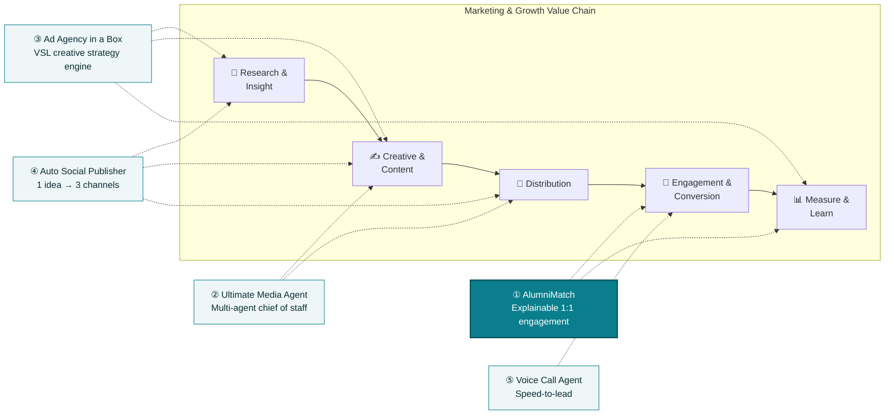

# 🤖 Agentic AI Automation Portfolio
### Five production-style n8n agent systems for marketing, growth & operations

**Arun Teja Kamisetti** · PGP, IIM Kozhikode · Ex-Software Engineer (Sandvine · Fidelity · Samsung R&D)
*Aspiring AI Product Manager. I build agents end-to-end: problem framing → architecture → guardrails → test harness → rollout.*

---

## 📌 TL;DR for recruiters

| | |
|---|---|
| **What** | 5 agent systems (13 workflow files, **280+ nodes**, **40+ integrations**) that automate marketing ops, content production, paid-ads creative strategy, alumni engagement and lead response |
| **Why it matters** | Each one targets a **high-frequency, low-leverage workflow** where human time is the bottleneck, and turns it into an **AI-first operating model with humans in the loop** |
| **PM skills shown** | Problem framing, user journeys, **North Star & guardrail metrics**, build-vs-buy, **responsible-AI guardrails**, test plans, rollout & cost observability |
| **Consulting skills shown** | **MECE process decomposition**, value-chain mapping, **cost-to-serve reduction**, operating-model redesign, governance & auditability |

---

## 🗺️ Portfolio at a glance

> Read as a **value-chain map**: together the agents cover the full marketing funnel, from research to measurement, with no gaps.

---

## 🧩 The agents

| # | Agent | Business problem | What it changes | Key design choices |
|---|---|---|---|---|
| ① | **[AlumniMatch](agents/01-alumnimatch/)** ⭐ *flagship* | Alumni offices send generic event blasts. Low relevance, fatigue, unsubscribes | Every invite is **1:1, explainable, policy-checked and human-approved** | Deterministic rules decide *who*; AI only decides *how to say it*. 100-pt scoring model, HITL approval, waitlist waterfall, 15-case test matrix |
| ② | **[Ultimate Media Agent](agents/02-ultimate-media-agent/)** | A creator or marketer juggles 10+ tools for one content task | **One Telegram chat** runs email, calendar, CRM, research, image/video generation and multi-platform posting | Hierarchical **orchestrator + 8 specialist agents, 34 tools**, LLM fallback, per-run **token-cost logging** |
| ③ | **[Ad Agency in a Box](agents/03-ad-agency-in-a-box/)** | Paid-social creative is slow, expensive and disconnected from what actually performs | Research → angles → VSL scripts → feedback loop, **seeded by the brand's own winning ads** | Closed learning loop: weekly Meta Ads harvest + Whisper transcripts of top ads feed the next angle generation |
| ④ | **[Auto Social Publisher](agents/04-auto-social-publisher/)** | Repurposing one idea for FB, IG and LinkedIn is manual and inconsistent | **1 niche or URL → 3 platform-native posts + 3 on-brand images**, queued and auto-published | Grounded in live web research (Tavily) to cut hallucination; Sheets acts as a content calendar with approval status |
| ⑤ | **[Voice Call Agent](agents/05-voice-call-agent/)** | Inbound leads go cold while waiting for a callback | Form submission → **AI voice call in seconds**, with context already loaded | Minimal 2-node design: fastest possible time-to-value |

---

## 📈 Impact framing (how I'd measure success)

I treat each agent as a product, so each one has a **North Star metric**, **input metrics** and **guardrail metrics**.

| Agent | North Star | Input metrics | Guardrails (must not get worse) |
|---|---|---|---|
| AlumniMatch | **Registrations per invite sent** | relevance-band mix, approval rate, time-to-approve | unsubscribe rate, frequency-cap breaches (**target 0**), consent violations (**target 0**) |
| Ultimate Media Agent | **Tasks completed per chat message** | tool-call success rate, avg. steps per task | token cost per task, error-message rate |
| Ad Agency in a Box | **Creative hit-rate** (share of scripts beating account-average CTR/ROAS) | angles per run, iteration cycles to approval | brand/compliance rejections |
| Auto Social Publisher | **Posts shipped per week per marketer** | idea → publish lead time, % auto-published | factual-error flags, off-brand image rejections |
| Voice Call Agent | **Speed-to-lead** (submit → call connected) | connect rate, call → meeting rate | opt-out / complaint rate |

> ✅ **Example (AlumniMatch).** A generic blast to 2,000 alumni means 2,000 emails and maybe 40 RSVPs. AlumniMatch instead scores everyone, invites only the top-relevance band within event capacity, and sends each email with its own "why you" reason. **Fewer emails, higher conversion, no fatigue.** That trade-off is exactly what the guardrail metrics are there to prove.

<!-- 📊 Add your real numbers here once you run pilots, e.g. "Cut content production time from ~3 hrs to ~10 min per post (n=20)". Only publish measured figures. -->

---

## 🏗️ Recurring architecture patterns

| Pattern | Where | Why it matters (PM lens) |
|---|---|---|
| **Deterministic core + generative edge** | AlumniMatch | Compliance-critical decisions stay rule-based and auditable; the LLM is boxed into copywriting |
| **Human-in-the-loop (HITL) approval** | AlumniMatch, Social Publisher | Builds trust for enterprise adoption, since nothing goes out unreviewed |
| **Hierarchical multi-agent orchestration** | Ultimate Media Agent | Separation of concerns, smaller prompts, easier debugging and model-per-task cost tuning |
| **Closed-loop learning from performance data** | Ad Agency in a Box | Creative is grounded in what *actually converted*, not opinion |
| **Retrieval / web-grounding before generation** | Social Publisher, Ad Agency | Lowers hallucination risk on factual claims |
| **Structured output schemas + fallbacks** | AlumniMatch, Ad Agency, Social Publisher | Predictable outputs downstream; graceful degradation when the LLM fails |
| **Observability & cost logging** | Ultimate Media Agent, AlumniMatch | Unit economics per task are visible, not guessed |

---

## 🛠️ Tech stack

**Orchestration:** n8n (agents, sub-workflows, webhooks, forms, schedules, Send-and-Wait)
**Models:** OpenAI GPT-5-mini / GPT-4.1-mini / GPT-4o / gpt-image-1 / Whisper · Google Gemini · Perplexity Sonar · fal.ai Veo 3
**Data & CRM:** Google Sheets · Airtable · Google Drive · Dropbox
**Channels:** Gmail · Google Calendar · Telegram · Meta Graph API (FB/IG Ads & Pages) · LinkedIn · X · TikTok (via Blotato) · Retell AI (voice)
**Research & scraping:** Tavily · Perplexity · Apify (IG / TikTok / YouTube) · Scrapfly · OpenWeatherMap

---

## 🚀 Run it yourself

1. In n8n: **Workflows → Import from file** → pick any `*.workflow.json` in `agents/`.
2. Re-link credentials (each agent README lists what's needed).
3. For the Ultimate Media Agent, import the 8 `sub-workflows/` first, then point each Tool node at them.

> 🔐 **Security:** all API keys and personal contact details have been removed from these exports. Credentials live in n8n's encrypted credential store, never in the JSON.

---

## 🙏 Credits

The **Ultimate Media Agent** and its sub-workflows are adapted from [Nate Herk's](https://www.youtube.com/@nateherk) open template. **Auto Social Publisher** started from a community template. I configured, extended and documented them, and the product framing, metrics and analysis here are my own. **AlumniMatch** is an original build (IIM Kozhikode, *Marketing Automation & Agentic Systems* course, Group 07).

**Let's talk AI products →** [LinkedIn](https://www.linkedin.com/in/YOUR-HANDLE) · [Portfolio](https://YOUR-SITE)

